# Awesome Embedded Spreadsheet Viewer & Editor 📊✨

  

  
  
  
  
  
  

---

## 🚀 Top Embedded Spreadsheet Viewer & Editor Ecosystem

> ⚡ **A curated list of enterprise SaaS platforms, in-app Excel-like components, open-source formula calculation engines, and white-label workbook viewers & editors.**  
> 📅 *Continuously updated for engineering, frontend, and product teams.*

Drop high-performance spreadsheet capabilities directly into your web applications, internal tools, and SaaS products. Whether you need read-only data tables with virtualized scrolling, Excel XLSX formula compatibility (VLOOKUP, SUMIFS), pivot tables, or real-time multi-user collaborative editing via CRDTs, this guide compares top commercial platforms and open-source libraries.

---

## 📑 Table of Contents

- [🌐 Sector Overview & Market Dynamics](#-sector-overview--market-dynamics)
- [💼 SaaS & Enterprise Hosted Platforms](#-saas--enterprise-hosted-platforms)
- [🔓 Open-Source GitHub Projects](#-open-source-github-projects)
- [💡 Architectural Guidance & Selection Advice](#-architectural-guidance--selection-advice)
- [🤝 How to Contribute](#-how-to-contribute)
- [💖 Support](#-support)
- [📈 Star History](#-star-history)
- [⚖️ Disclaimer](#-disclaimer)

---

## 🌐 Sector Overview & Market Dynamics

The global spreadsheet software and developer UI component ecosystem represents an estimated **$11.5B to $14B+** market, supported by a rapid 14–16% CAGR across developer construction tools and data grid SDKs. The sector exhibits **moderate fragmentation with specialized concentration**: while dominant office productivity suites (Microsoft Excel, Google Sheets) command the general end-user sphere, the embedded/in-app developer component space is contested between specialized high-scale UI component giants (Syncfusion, MESCIUS/GrapeCity), dedicated performance grid leaders (AG Grid, Handsontable), and an expanding cohort of modern open-source engines (Univer, Jspreadsheet).

---

## 💼 SaaS & Enterprise Hosted Platforms

| Product | Company Scale (Revenue / Valuation) | Pricing (Starting) | Free Tier / Trial Limits | Description |
|---------|-------------------------------------|-------------------|--------------------------|-------------|
| **[Syncfusion Essential JS 2 Spreadsheet](https://www.syncfusion.com/)** | **~$176M – $200M+** ARR; 2,000+ employees (Bootstrapped / Private) | **$1,199/developer/year** (5-developer team minimum: $5,995/year); or **$959/developer/year** (Grid-only package) | **Free (Community License)**: Full commercial access for companies with <$1M annual gross revenue, ≤5 developers, and ≤10 employees; otherwise standard 30-day evaluation trial | 📊 Full spreadsheet component within a 140+ component suite. Supports formulas, multiple sheets, charts, conditional formatting, and Excel import/export. |
| **[SpreadJS (MESCIUS / GrapeCity)](https://www.grapecity.com.cn/developer/spreadjs)** | **~$50M – $100M+** estimated global revenue; 400+ employees (Private equity backed by iSigma Capital) | **$1,999/developer/year** (includes 1 Developer license + 1 annual Hostname deployment + Designer App; China direct: **¥9,800/dev**) | **30-day full-featured free trial**; permanent free tier not available for commercial production | 🏆 **The most Excel-compatible commercial spreadsheet component.** Canvas rendering with sparse arrays for millions of cells, **90%+ Excel function compatibility**, 513 calculation formulas, and high-fidelity import/export. Plugin ecosystem covers reporting, pivot tables, Gantt, and AI. |
| **[AG Grid](https://www.ag-grid.com/)** | **~£25M (~$32M) EBITDA** / **£10M–£50M ARR**; Enterprise buyout backed by Adelis Equity Partners | **$999/developer** (Enterprise perpetual license with 1 year support); Enterprise Bundle with Integrated Charts: **$1,498/developer** | **Free forever (Community Edition)**: MIT-licensed core grid; Enterprise features include **30-day evaluation trial** (unrestricted features, evaluation purposes only) | ⚡ **High-performance data grid with spreadsheet-like features in Enterprise tier.** Range selection, fill handle, clipboard, formulas, pivoting, server-side row model, and Excel export. Primarily an enterprise data grid with spreadsheet behaviors. |
| **[Webix Spreadsheet](https://webix.com/)** | **~$15.1M** ARR; ~130–150 employees (XB Software / Private) | **$2,499** one-time purchase (Company Pack for 1 project, 1 dev); DevTeam Pack: **$3,999**; Unlimited Pack: **$9,499** | **30-day full-featured Pro trial** (technical support included); Webix Standard (GPLv3) is free for open-source projects only and excludes complex widgets like Spreadsheet | 🗂️ Spreadsheet widget within the Webix JS UI library. Pack pricing includes PRO library, one year of updates, and support. Complex widgets include source code. |
| **[DHTMLX Spreadsheet](https://dhtmlx.com/)** | **~$1M – $5M** estimated ARR; 10–50 employees (Dinamenta, UAB / Private) | **$2,499** one-time purchase (Company license for 1 project, 1 dev); DevTeam: **$3,999** (up to 5 devs); Unlimited: **$9,499** | **30-day full-featured Pro trial** (`@dhx/trial-spreadsheet` evaluation only); Community Edition is free forever under GPLv2 for open-source apps only | 📑 Spreadsheet component within the DHTMLX UI suite. No additional deployment fees for end-user applications; SaaS license is fixed-price for life. One-time purchase with optional support renewal. |
| **[Handsontable](https://handsontable.com/)** | **~$1M – $3M** ARR; ~15–20 employees (Handsoncode / Bootstrapped) | **$999/developer/year** (Standard plan); Priority: **$1,299/developer/year**; Enterprise custom | **45-day full-feature trial** (no credit card required); **Free forever Hobby License** for non-commercial and open-source use | ⌨️ **Excel-style editing component focused on familiar spreadsheet interaction.** Strong keyboard navigation, copy/paste workflows, cell validation, and formulas via HyperFormula. Ideal for CRUD screens, data-entry workflows, and pricing matrices. |
| **[Jspreadsheet (Pro)](https://jspreadsheet.com/)** | **<$1M** estimated ARR; niche developer team (Boutique / Self-funded) | **$49/month** (Standard plan per feature) or **$199/month** (Enterprise plan with Formula Pro & XLSX import/export) | **Free forever (Community Edition)**: MIT-licensed base grid; Pro includes **30-day evaluation trial** (and unlimited evaluation on `localhost`) | 📋 Lightweight JavaScript spreadsheet with classic web spreadsheet UI. Community Edition is open-source; Pro adds advanced features, formulas, and enterprise extensions. |

---

## 🔓 Open-Source GitHub Projects

Sorted in descending order by GitHub Stars ⭐. Every repo links directly to its official stargazers page.

| Project | Stars | Language / Stack | License | Description |
|---------|-------|------------------|---------|-------------|
| **[SheetJS / js-xlsx](https://github.com/SheetJS/sheetjs)** |  | JavaScript / TypeScript | Apache-2.0 | 📗 **The undisputed standard for spreadsheet data parsing and processing.** Comprehensive toolkit for parsing, validating, generating, and converting XLSX, XLS, CSV, and ODS formats across browsers and Node.js. |
| **[Univer](https://github.com/dream-num/univer)** |  | TypeScript / Canvas | Apache-2.0 | 🌟 **The successor to Luckysheet and the most ambitious open-source AI-native spreadsheet framework.** Full-stack framework for web and server with real-time multi-user collaboration, formula calculation engine, XLSX import/export, and LLM agent integration via Univer MCP. |
| **[Handsontable CE](https://github.com/handsontable/handsontable)** |  | TypeScript / JS / React / Vue / Angular | Commercial / Free Evaluation | ⚡ **Data Grid & Data Table with authentic spreadsheet look & feel.** Virtualized scrolling, context menus, Excel clipboard support, and integration with HyperFormula for reactive workbook calculation. |
| **[Luckysheet](https://github.com/mengshukeji/Luckysheet)** |  | JavaScript | MIT | 📖 **Pioneering browser-based online spreadsheet component.** Fully featured with Excel formula support, cell styling, chart plugins (chartMix), and XLSX import (Luckyexcel). *Note: Upgraded and succeeded by the Univer project.* |
| **[AG Grid Community](https://github.com/ag-grid/ag-grid)** |  | TypeScript / React / Angular / Vue | MIT | 🚀 **High-performance enterprise data table and grid library.** Industry standard for rendering millions of data points with keyboard cell navigation, filtering, sorting, and spreadsheet-like cell editing. |
| **[x-spreadsheet](https://github.com/myliang/x-spreadsheet)** |  | JavaScript / Canvas | MIT | 🎨 **Lightweight canvas-based web spreadsheet library.** Fast, clean, and easily embeddable with formulas, cell formatting, and merge capabilities. Migrated to `@wolf-table/table` for active modern development. |
| **[Jspreadsheet CE](https://github.com/jspreadsheet/ce)** |  | JavaScript | MIT | 📝 **Lightweight interactive JavaScript data grid with spreadsheet controls.** Delivers rich Excel-like features including formula execution, drag-to-fill handle, context menus, and multi-sheet support. |
| **[Glide Data Grid](https://github.com/glideapps/glide-data-grid)** |  | TypeScript / React / HTML5 Canvas | MIT | 🏎️ **Ultra-fast, virtualized React canvas data grid from Glide.** Renders millions of cells effortlessly at 60 FPS with first-class keyboard navigation, copy/paste, image rendering, and markdown cell support. |
| **[IronCalc](https://github.com/ironcalc/IronCalc)** |  | Rust / WebAssembly / Python / JS | Apache-2.0 / MIT | 🦀 **Modern, blazingly fast spreadsheet engine written in Rust.** Runs natively on desktop, server, and in-browser via WebAssembly. Engineered for rock-solid calculation models, auditability, and headless workbook calculations. |
| **[FortuneSheet](https://github.com/ruilisi/fortune-sheet)** |  | TypeScript / React | MIT | 🍀 **A modern React-based drop-in spreadsheet component fork inspired by Luckysheet.** Solves legacy architecture bottlenecks with TypeScript re-engineering, clean hooks, and full Excel-like editing experience. |
| **[HyperFormula](https://github.com/handsontable/hyperformula)** |  | TypeScript | GPLv3 / Commercial | 🧮 **Headless spreadsheet calculation engine with 400+ built-in formulas.** Operates completely decoupled from the UI—ideal for backend calculations, DAG dependency graphs, CRUD validation, and syncing with frontend grids. |
| **[Wolf Table](https://github.com/wolf-table/table)** |  | TypeScript / Canvas | MIT | 🐺 **The next-generation successor to x-spreadsheet.** Canvas-rendered table engine with high rendering speed, modern architecture, and minimal memory footprints for high-density tabular editing. |
| **[Spindle](https://github.com/b32n/spindle)** |  | TypeScript / React | MIT | 🧵 **Forever-free open-source spreadsheet, docs, and slides editing libraries for React.** Engineered for virtual scrolling, 146 dynamic array formulas, and collaborative editing via Yjs CRDT. |

---

## 💡 Architectural Guidance & Selection Advice

When selecting an embedded spreadsheet engine or data grid for your product:

1. **Full Workbook Parity vs. Data Grid**:
   - If your users expect full Excel behavior (multi-sheet tabs, 400+ formula functions, cross-sheet formulas, floating charts, and pivot tables), choose a dedicated engine like **SpreadJS** (Commercial) or **Univer** (Open Source).
   - If your app primarily needs fast database record editing, sorting, filtering, and row grouping with light formula touches, choose **AG Grid**, **Handsontable**, or **Glide Data Grid**.
2. **Headless & Server-Side Calculation**:
   - For recalculating complex client models on the backend without running a browser instance, look to **HyperFormula** or **IronCalc** (Rust/WASM).
3. **Deployment Licensing**:
   - Be mindful of commercial license types: per-developer seats vs. per-domain hostname deployment fees. Check open-source licenses carefully (Apache-2.0 and MIT are unrestrictive; GPL options like Webix Standard or HyperFormula require open-sourcing client code or purchasing commercial waivers).

---

## 🤝 How to Contribute

We love community contributions! To add a new platform, library, or update pricing details:

1. 🍴 Fork this repository.
2. 🌿 Create a new feature branch (`git checkout -b feature/add-new-spreadsheet`).
3. 📝 Update `README.md` following the established table formats (ensure pricing, free tier limits, star badges, and descriptions are factual).
4. 🚀 Commit your changes (`git commit -m "feat: add NewSpreadsheet engine"`).
5. 📬 Submit a Pull Request.

---

## 💖 Support

If you find this curated collection helpful for your engineering projects or technical evaluations, please consider supporting the project:

- ⭐ **Star this repository** to help other developers discover it!
- 🍴 **Fork and share** with fellow frontend and product engineers!
- ☕ **Sponsor & Buy a Coffee**: If this repository saved you engineering hours or software evaluation time, support ongoing curation on the [GitHub Sponsor Dashboard](https://github.com/sponsors/ishandutta2007).

---

## 📈 Star History

---

## ⚖️ Disclaimer

- This is an independent **community-curated** list — not sponsored or endorsed by any vendor.
- Embedded spreadsheet components process user-submitted data and execute formulas in the browser; ensure proper data sanitization and sandboxing for untrusted inputs.
- Pricing, trial policies, and commercial licensing tiers are subject to change by respective vendors. Always verify exact terms on official vendor portals before entering enterprise production commitments.

---

  <b>Built with ❤️ for product engineers, frontend developers, and data teams worldwide.</b>

